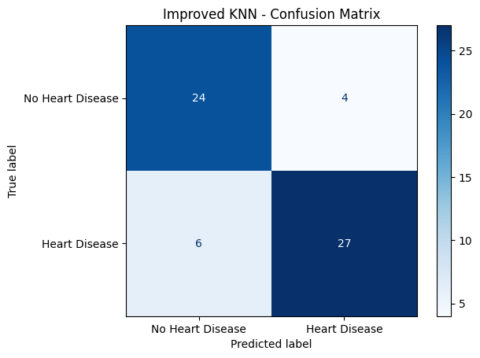

[](https://colab.research.google.com/github/sakshi66-707/heart-disease-prediction-ml/blob/main/Heart_Disease_Prediction_GitHub.ipynb)

# Heart Disease Prediction Using Machine Learning

## Project Overview

This project explores the prediction of heart disease using supervised machine learning algorithms. It is an improved version of my undergraduate machine learning project from 2022, revisited with a focus on data quality, preprocessing, model evaluation, and reproducibility.

The objective is to compare classification algorithms and investigate how preprocessing and hyperparameter tuning affect predictive performance.

**Note:** This is an educational machine learning project, not a medical diagnostic tool.

## Dataset

**Source:** [Heart Disease Dataset — Kaggle](https://www.kaggle.com/datasets/johnsmith88/heart-disease-dataset)

The dataset contains patient-related attributes such as age, cholesterol, resting blood pressure, maximum heart rate, and other cardiovascular indicators.

- Original dataset: 1,025 rows and 14 columns
- Duplicate rows removed: 723
- Unique records after cleaning: 302
- Target variable: `target`
- Classification task: Binary classification

Duplicate records were removed before splitting the data to reduce the risk of identical records appearing in both training and testing.

## Technologies Used

- Python
- Google Colab / Jupyter Notebook
- Pandas and NumPy
- Matplotlib
- Scikit-learn

## Machine Learning Models

The following algorithms were evaluated:

1. Logistic Regression
2. Gaussian Naive Bayes
3. K-Nearest Neighbors (KNN)
4. Random Forest
5. Improved KNN with feature-specific preprocessing and hyperparameter tuning

## Methodology

The project follows these steps:

1. Load and explore the dataset.
2. Identify and remove duplicate records.
3. Split the cleaned data into stratified training and testing sets.
4. Apply preprocessing within machine learning pipelines.
5. Train and evaluate baseline classification models.
6. Improve KNN using numerical feature scaling, categorical feature encoding, and GridSearchCV.
7. Compare all five model configurations using stratified five-fold cross-validation on the training set.
8. Perform a separate nested five-fold cross-validation experiment for improved KNN using the full cleaned dataset.


## Model Performance

Results from the 80/20 train-test split:

| Model                  | Test Accuracy |
| ---------------------- | ------------- |
| Logistic Regression    | 80.33%        |
| Gaussian Naive Bayes   | 78.69%        |
| KNN (K=12)             | 80.33%        |
| Random Forest          | 77.05%        |
| **Improved KNN (K=5)** | **83.61%**    |

Improved KNN achieved the highest accuracy on this particular test split.


### Five-Model Classification Metrics Comparison

The following metrics were calculated on the same held-out test set of 61 records. Precision, recall, and F1-score refer to the positive class (heart disease).

| Model | Accuracy | Precision | Recall | F1-Score |
|---|---:|---:|---:|---:|
| Logistic Regression | 80.33% | 80.00% | 84.85% | 82.35% |
| Gaussian Naive Bayes | 78.69% | 83.33% | 75.76% | 79.37% |
| KNN (K=12) | 80.33% | 80.00% | 84.85% | 82.35% |
| Random Forest | 77.05% | 78.79% | 78.79% | 78.79% |
| **Improved KNN (Tuned)** | **83.61%** | **87.10%** | 81.82% | **84.38%** |

Improved KNN achieved the highest accuracy, precision, and F1-score on this test split. Logistic Regression and baseline KNN achieved the highest recall (84.85%), illustrating the trade-off between precision and recall.

These results are exploratory and should be interpreted cautiously because the test set contains only 61 records.

### Five-Fold Cross-Validation Comparison

To compare the five model configurations more consistently, stratified five-fold cross-validation was performed on the training dataset using the same outer folds for all models. Hyperparameter tuning for improved KNN was performed within each training fold.

| Model | Mean CV Accuracy ± Std Dev |
|---|---|
| Logistic Regression | 83.79% ± 8.61 pp |
| Gaussian Naive Bayes | 81.72% ± 4.89 pp |
| KNN (K=12) | 80.88% ± 4.90 pp |
| **Random Forest** | **85.88% ± 6.12 pp** |
| Improved KNN (Tuned) | 83.79% ± 4.88 pp |

Random Forest achieved the highest mean cross-validation accuracy. However, the differences between models were modest relative to the variability across folds, so these results do not establish that one model is definitively superior.

*Note: pp = percentage points. Cross-validation was performed on the training dataset, keeping the held-out test set separate.*


### Improved KNN - Classification Report and Confusion Matrix

The improved KNN model was evaluated on the held-out test set of 61 records.

| Metric | Result |
|---|---|
| Test Accuracy | 83.61% |
| Precision (Heart Disease) | 87.10% |
| Recall (Heart Disease) | 81.82% |
| F1-Score (Heart Disease) | 84.38% |

**Confusion Matrix Results:**
- True Negatives: 24
- False Positives: 4
- False Negatives: 6
- True Positives: 27

The model correctly identified 27 of the 33 heart disease cases but missed 6. Recall is particularly important in this task because false negatives represent positive cases incorrectly classified as negative.

These results are based on a small test set and should not be interpreted as evidence of clinical reliability.




### Nested Cross-Validation

As a separate exploratory experiment, nested five-fold cross-validation was performed on the full cleaned dataset to evaluate the improved KNN approach with hyperparameter tuning performed within each outer training fold.

- Mean accuracy: **80.78%**
- Standard deviation: **5.37 percentage points**

**Why the cross-validation results differ:** The five-model comparison used the 241-record training set, with three-fold inner hyperparameter tuning for improved KNN. The separate nested cross-validation experiment used all 302 cleaned records, with five-fold inner tuning and a different outer-fold split. Consequently, the reported mean accuracies are not directly comparable.

The nested experiment included records from the original held-out test set, so it should be interpreted as a separate exploratory evaluation rather than an independent validation of the selected model.

The difference between test accuracy and cross-validation accuracy illustrates how model performance can vary across data splits.

## Improvements Over the Original Project

Compared with the undergraduate version, this project introduces:

- Duplicate detection and removal before model training
- Consistent train-test splitting for baseline comparisons
- Preprocessing pipelines to reduce data leakage
- Separate treatment of numerical and categorical features
- Hyperparameter tuning with GridSearchCV
- Evaluation using accuracy, precision, recall, and F1-score
- Nested cross-validation for improved KNN

These improvements strengthen the evaluation methodology, although they do not guarantee higher predictive accuracy.


## Key Findings

- Removing duplicate records reduced the dataset from 1,025 to 302 unique observations.
- Improved KNN achieved the highest accuracy (83.61%) on the held-out test split.
- Improved KNN achieved 81.82% recall for heart disease cases, correctly identifying 27 of 33 positive cases.
- Random Forest achieved the highest mean accuracy (85.88%) in the five-model cross-validation comparison.
- The differences between cross-validation results were modest relative to their variability, so no model can be considered definitively superior.
- Performance on a single test split does not necessarily reflect generalization to new data.

## Limitations

- The cleaned dataset contains only 302 unique records.
- The held-out test set contains 61 records, making performance estimates sensitive to individual predictions.
- All five model configurations were compared using five-fold cross-validation, but nested hyperparameter tuning was performed only for improved KNN.
- Multiple models were explored using the same test set, so the highest test accuracy should be interpreted as exploratory.
- The dataset and models are intended for educational research and are not validated for clinical decision-making.

## How to Run

1. Download or open `Heart_Disease_Prediction_GitHub.ipynb` in Google Colab.
2. Download `archive.zip` from the Kaggle dataset linked above.
3. Run the notebook's upload cell and select `archive.zip`.
4. Run the remaining cells in order.

The notebook contains the preprocessing, model training, evaluation, and cross-validation workflow.


### Dependencies

The Python libraries and their tested versions are listed in `requirements.txt`.

To install the dependencies in a local Python environment, run:

```bash
pip install -r requirements.txt
```

Alternatively, click the **Open in Colab** badge at the top of this README to open the notebook in Google Colab. Download the dataset from Kaggle and upload `archive.zip` when prompted.


## Future Improvements

Potential extensions include evaluating additional algorithms with nested cross-validation, studying feature importance, and validating the approach on an independent dataset.

---

**Project Type:** Machine Learning | Binary Classification | Python

**Project Background:** Undergraduate machine learning project (2022), revisited and improved (2026).
